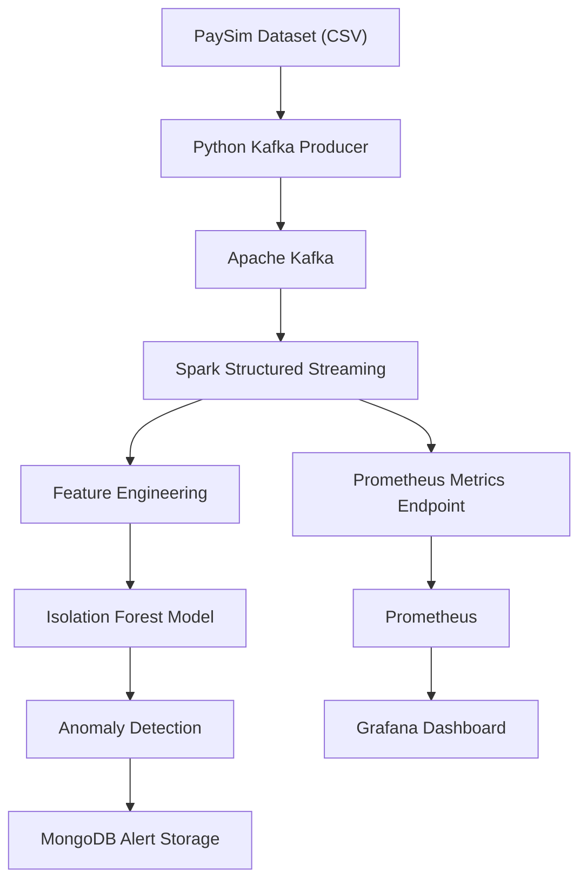

# 🚨 Real-Time Financial Fraud Detection System

A real-time financial transaction monitoring system built using **Apache Kafka, Apache Spark Structured Streaming, Machine Learning, MongoDB, Prometheus, and Grafana**.

The system streams financial transactions from the PaySim dataset through Kafka, processes them using Spark, detects suspicious transaction patterns using an Isolation Forest model, stores anomaly alerts in MongoDB, and exposes monitoring metrics through Prometheus for visualization in Grafana.

> **Project type:** End-to-end Data Engineering + Machine Learning
> **Language:** Python
> **Status:** Streaming pipeline implemented; monitoring dashboards configured

---

## 📌 Table of Contents

* [Overview](#-overview)
* [Key Features](#-key-features)
* [System Architecture](#-system-architecture)
* [Technology Stack](#-technology-stack)
* [Dataset](#-dataset)
* [Machine Learning Approach](#-machine-learning-approach)
* [Project Structure](#-project-structure)
* [Prerequisites](#-prerequisites)
* [Installation and Setup](#-installation-and-setup)
* [Running the Pipeline](#-running-the-pipeline)
* [Monitoring and Metrics](#-monitoring-and-metrics)
* [Sample Results](#-sample-results)
* [Screenshots](#-screenshots)
* [Limitations](#-limitations)
* [Future Improvements](#-future-improvements)
* [Author](#-author)

---

## 📖 Overview

Financial fraud detection is important for identifying unusual transaction patterns and reducing potential financial losses.

Traditional batch-processing systems may not identify suspicious transactions until after a processing cycle has completed. This project demonstrates a streaming-based approach that continuously consumes transactions, generates features, and applies a machine learning model to flag anomalous activity.

The system uses an **Isolation Forest anomaly detection model** to identify unusual transactions. Detected anomalies are stored in MongoDB and tracked through real-time application metrics.

### Project objectives

* Stream financial transactions using Apache Kafka.
* Process transaction data using Spark Structured Streaming.
* Engineer transaction-based features for machine learning.
* Identify suspicious transactions using Isolation Forest.
* Store anomaly alerts in MongoDB.
* Monitor transaction-processing activity using Prometheus.
* Visualize pipeline metrics using Grafana.

## ✨ Key Features

* **Real-time streaming:** Consume financial transactions from a Kafka topic.
* **Stream processing:** Process incoming transaction batches using Spark Structured Streaming.
* **Feature engineering:** Calculate balance changes, transaction ratios, and transaction-hour features.
* **Machine learning:** Use Isolation Forest to identify anomalous transactions.
* **Alert storage:** Store detected anomaly records in MongoDB.
* **Metrics monitoring:** Track transaction counts, anomaly alerts, and processed batches.
* **Visualization:** Use Grafana dashboards to monitor pipeline performance.
* **Containerized infrastructure:** Run supporting services using Docker containers.

## 🏗️ System Architecture



### Workflow

1. The Kafka producer reads transaction records from the PaySim CSV dataset.
2. The producer publishes transaction messages to the `financial-transactions` Kafka topic.
3. Spark Structured Streaming consumes messages from Kafka.
4. Transaction data is parsed and transformed into a Spark DataFrame.
5. Python-based feature engineering prepares the model input.
6. The trained Isolation Forest model predicts whether each transaction is normal or anomalous.
7. Anomaly alerts are saved to MongoDB.
8. Prometheus collects application metrics, which are visualized in Grafana.

## 🛠️ Technology Stack

| Category                | Technologies                                              |
| ----------------------- | --------------------------------------------------------- |
| Programming language    | Python 3.11                                               |
| Streaming platform      | Apache Kafka 4.0.1                                        |
| Stream processing       | Apache Spark Structured Streaming 4.2.0                   |
| Machine learning        | Scikit-learn, Isolation Forest                            |
| Data processing         | Pandas, NumPy                                             |
| Message serialization   | JSON                                                      |
| Database                | MongoDB 8.0                                               |
| Metrics collection      | Prometheus                                                |
| Monitoring dashboards   | Grafana                                                   |
| Containerization        | Docker                                                    |
| Development environment | Visual Studio Code, PowerShell                            |
| Python dependencies     | PySpark, kafka-python, PyMongo, joblib, prometheus-client |

*Versions listed reflect the development environment where known. Check the installed versions if reproducing the project elsewhere.*

## 📊 Dataset

This project uses the **PaySim synthetic financial transaction dataset**.

The original dataset contains approximately 6.36 million transactions and includes transaction information, sender and receiver balances, and fraud-related labels.

### Dataset characteristics

* Approximately 6.36 million transaction records.
* 11 original columns.
* Transaction types such as CASH-IN, CASH-OUT, DEBIT, PAYMENT, and TRANSFER.
* Original fraud labels available for offline analysis and evaluation.

### Dataset columns

| Column           | Description                               |
| ---------------- | ----------------------------------------- |
| `step`           | Time step of the transaction              |
| `type`           | Transaction type                          |
| `amount`         | Transaction amount                        |
| `nameOrig`       | Sender identifier                         |
| `oldbalanceOrg`  | Sender's balance before the transaction   |
| `newbalanceOrig` | Sender's balance after the transaction    |
| `nameDest`       | Receiver identifier                       |
| `oldbalanceDest` | Receiver's balance before the transaction |
| `newbalanceDest` | Receiver's balance after the transaction  |
| `isFraud`        | Original dataset fraud label              |
| `isFlaggedFraud` | Original dataset flag indicator           |

Download the dataset from its original distribution source or a trusted PaySim dataset repository. Place the CSV file at:

```text
data/raw/PS_20174392719_1491204439457_log.csv
```

The original dataset is not required to be committed to GitHub; it is large and may have separate redistribution terms.

## 🤖 Machine Learning Approach

The project uses **Isolation Forest**, an unsupervised anomaly detection algorithm.

Isolation Forest identifies observations that can be isolated more easily than typical observations. These observations are treated as potential anomalies.

### Engineered features

The following features are calculated before prediction:

| Feature                 | Calculation                       |
| ----------------------- | --------------------------------- |
| `balance_change_orig`   | `oldbalanceOrg - newbalanceOrig`  |
| `balance_change_dest`   | `newbalanceDest - oldbalanceDest` |
| `amount_to_old_balance` | `amount / (oldbalanceOrg + 1)`    |
| `transaction_hour`      | `step % 24`                       |

These features are combined with the original transaction amount, balances, and `isFlaggedFraud` indicator.

### Prediction interpretation

* `1` — Normal transaction according to the model.
* `-1` — Anomalous transaction according to the model.

The streaming application maps `-1` to `FRAUD` and `1` to `NORMAL` for its current alert output. Technically, these are **model-predicted anomalies**, not confirmed fraudulent transactions.

The trained model is stored at:

```text
models/fraud_model.pkl
```

The streaming application loads this model to make predictions on incoming transactions.

## 📁 Project Structure

```text
Real-Time-Financial-Fraud-Detection/
│
├── data/
│   ├── raw/
│   │   └── PS_20174392719_1491204439457_log.csv
│   └── processed/
│       └── processed_transactions.csv
│
├── models/
│   └── fraud_model.pkl
│
├── scripts/
│   ├── feature_engineering.py
│   ├── fraud_analysis.py
│   ├── inspect_dataset.py
│   ├── kafka_producer.py
│   ├── spark_kafka_stream.py
│   ├── train_fraud_model.py
│   └── tune_fraud_model.py
│
├── docker/
│   └── prometheus.yml
│
├── checkpoints/
│   └── fraud-stream/
│
├── requirements.txt
└── README.md
```

The checkpoint directory is created by Spark at runtime. Exact local files may vary. Large datasets, generated artifacts, virtual environments, and runtime checkpoints should generally be excluded from version control unless intentionally required.

## ⚙️ Prerequisites

Install the following before running the application:

1. Python 3.11.
2. Java Development Kit (JDK) 17.
3. Docker Desktop.
4. Apache Kafka running in Docker.
5. MongoDB running in Docker.
6. Prometheus and Grafana running in Docker.
7. Hadoop Windows utilities if running the Spark application natively on Windows.

The development environment uses these service endpoints:

| Service             | Address           |
| ------------------- | ----------------- |
| Kafka               | `localhost:9092`  |
| MongoDB             | `localhost:27017` |
| Prometheus          | `localhost:9090`  |
| Grafana             | `localhost:3000`  |
| Application metrics | `localhost:8000`  |

These are local development addresses, not production deployment settings.

## 🚀 Installation and Setup

### 1. Clone the repository

```bash
git clone https://github.com/YOUR_USERNAME/Real-Time-Financial-Fraud-Detection.git
cd Real-Time-Financial-Fraud-Detection
```

Replace `YOUR_USERNAME` with your GitHub username.

### 2. Create and activate a virtual environment

On Windows PowerShell:

```powershell
python -m venv venv
.\venv\Scripts\Activate.ps1
```

If PowerShell blocks script activation, follow the official Python or PowerShell guidance for virtual environments and execution policies.

### 3. Install Python dependencies

```powershell
python -m pip install --upgrade pip
pip install -r requirements.txt
```

Ensure the environment includes the dependencies used by the scripts, including PySpark, Pandas, Scikit-learn, Joblib, `kafka-python`, PyMongo, and `prometheus-client`.

### 4. Configure Hadoop for Windows

For the current native Windows Spark setup, configure the Hadoop utilities in the same PowerShell session used to start Spark.

Example:

```powershell
$env:HADOOP_HOME = "C:\hadoop"
$env:JAVA_TOOL_OPTIONS = "-Dhadoop.home.dir=C:\hadoop"
$env:PATH = "C:\hadoop\bin;$env:PATH"
```

Verify the utility exists:

```powershell
Test-Path "$env:HADOOP_HOME\bin\winutils.exe"
```

Expected output:

```text
True
```

The Hadoop directory must contain compatible Windows utilities. These settings are specific to the local Windows environment and may differ on Linux or containerized deployments.

### 5. Start the supporting services

Start Kafka, MongoDB, Prometheus, and Grafana using the project's Docker Compose configuration if available.

Verify the running containers:

```powershell
docker ps
```

The development setup uses containers named:

```text
fraud-kafka
fraud-mongodb
fraud-prometheus
fraud-grafana
```

If you are recreating the environment from scratch, configure the Kafka topic, Docker networking, Prometheus scrape target, and service ports before continuing.

### 6. Verify the Kafka topic

The application expects a topic named:

```text
financial-transactions
```

Check that it exists and has partitions:

```powershell
docker exec fraud-kafka /opt/kafka/bin/kafka-topics.sh --bootstrap-server localhost:9092 --describe --topic financial-transactions
```

### 7. Verify the model and dataset

Confirm that these files exist:

```text
data/raw/PS_20174392719_1491204439457_log.csv
models/fraud_model.pkl
```

If the model artifact is not included in the repository, train it using the project's training script and ensure the resulting feature columns match the streaming application's expected input.

## ▶️ Running the Pipeline

Run the services in the following order. Keep the streaming process running while publishing transactions.

### Step 1: Start Spark Structured Streaming

In the first PowerShell terminal, activate the virtual environment, set the Windows environment variables, and run:

```powershell
python .\scripts\spark_kafka_stream.py
```

The application starts Spark, loads the trained model, connects to MongoDB, subscribes to Kafka, and exposes Prometheus metrics on port `8000`.

Expected startup messages include:

```text
Prometheus metrics server started on port 8000.
Spark started successfully.
Fraud model loaded successfully.
Connected to MongoDB successfully.
Connecting to Kafka...
Spark is now detecting fraud from Kafka transactions...
```

### Step 2: Publish transactions to Kafka

In a second terminal, activate the virtual environment and run:

```powershell
python .\scripts\kafka_producer.py
```

The producer reads the PaySim CSV file and sends up to 10,000 transaction messages per execution.

Expected completion output:

```text
========== PRODUCER COMPLETE ==========
Total transactions sent: 10000
```

The configured delay between messages is `0.01` seconds, although total execution time also depends on file reading and Kafka processing.

### Step 3: Verify the application metrics

In another PowerShell terminal, run:

```powershell
Invoke-RestMethod http://localhost:8000/metrics
```

To display only the main project metrics:

```powershell
Invoke-RestMethod http://localhost:8000/metrics |
Select-String "transactions_processed_total|fraud_detected_total|batches_processed_total"
```

### Step 4: Verify MongoDB alerts

Check the number of stored alert documents:

```powershell
docker exec fraud-mongodb mongosh fraud_detection --quiet --eval "db.fraud_alerts.countDocuments({})"
```

The document count can increase across repeated runs because the application inserts new alert documents without automatically clearing previous results.

## 📈 Monitoring and Metrics

The application exposes metrics through the Python Prometheus client.

### Custom metrics

| Metric                         | Type    | Description                                            |
| ------------------------------ | ------- | ------------------------------------------------------ |
| `transactions_processed_total` | Counter | Total transactions processed by the streaming callback |
| `fraud_detected_total`         | Counter | Total anomaly alerts generated by the model            |
| `batches_processed_total`      | Counter | Number of non-empty Spark batches processed            |

Prometheus is configured to scrape the application metrics endpoint using the target:

```yaml
global:
  scrape_interval: 5s

scrape_configs:
  - job_name: "fraud_detection"
    static_configs:
      - targets: ["host.docker.internal:8000"]
```

This target is intended for Docker Desktop on Windows. On other environments, the hostname and networking configuration may need to change.

### Grafana dashboards

The dashboards can be used to visualize:

* Transactions processed.
* Anomaly alerts generated.
* Spark batches processed.
* Metric trends over time.

For the dashboards to show data, Prometheus must successfully scrape the application endpoint, and the Grafana Prometheus data source must be configured to reach Prometheus through the appropriate Docker network address.

## 📊 Sample Results

During one development test, the following results were observed:

| Metric                                      | Observed value |
| ------------------------------------------- | -------------: |
| Transaction messages sent by producer       |         10,000 |
| Transactions processed by Spark             |         10,000 |
| Spark batches processed                     |             53 |
| Anomaly alerts generated in that run        |            237 |
| Alert documents currently stored in MongoDB |          1,422 |

These are **sample results from a development run**, not guaranteed results for every execution.

The number of batches depends on streaming scheduling and Kafka consumption. Alert totals depend on the data, model, and checkpoint progress. The MongoDB document count may include alerts from earlier runs.

The 237 alerts represent model-identified anomalies; they should not be interpreted as 237 confirmed fraud cases.


### Grafana Monitoring Dashboard


## ⚠️ Limitations

1. **Anomaly detection is not fraud confirmation.** Isolation Forest identifies unusual patterns, which may include legitimate transactions.
2. **Model evaluation needs further work.** Operational alert counts alone do not establish precision, recall, F1-score, or financial impact. Evaluate against verified labels on a held-out dataset.
3. **Class imbalance matters.** Fraud is rare in the dataset, so accuracy alone would be an inadequate evaluation measure.
4. **Batch-based processing.** Spark Structured Streaming uses micro-batches in this implementation; it is not a guarantee of per-transaction, sub-millisecond processing.
5. **Development configuration.** Local hostnames, Windows Hadoop utilities, fixed service ports, and local model paths need changes for portable deployment.
6. **Checkpoint considerations.** Spark checkpoints preserve streaming progress. Restarting a query with an existing checkpoint generally resumes from saved offsets rather than replaying the topic from the beginning.
7. **Duplicate alert handling.** Replaying data or starting a new checkpoint can create duplicate alert records unless event identifiers and idempotent writes are implemented.
8. **Model and schema consistency.** The model's feature order, data types, preprocessing, and streaming schema must remain consistent.
9. **Security and production readiness.** Authentication, secrets management, encryption, access control, retention policies, and production monitoring require additional configuration.
10. **Dataset limitations.** PaySim is synthetic and may not capture the full complexity of real financial transaction behavior.

## 🔮 Future Improvements

* Evaluate the model using precision, recall, F1-score, PR-AUC, and confusion matrices.
* Compare Isolation Forest with supervised models such as Random Forest and XGBoost.
* Add deduplication and idempotent MongoDB writes.
* Add event timestamps, alert severity, and transaction identifiers.
* Build alert investigation and filtering features in Grafana or a dedicated application.
* Add unit tests, integration tests, and automated model validation.
* Add Docker Compose configuration and a reproducible deployment workflow.
* Introduce model versioning, drift monitoring, and periodic retraining.
* Add automated CI checks through GitHub Actions.
* Secure service credentials and prepare the system for cloud deployment.

## 👩‍💻 Author

**Sabana Fathima**

B.Tech Computer Science and Engineering — Artificial Intelligence and Machine Learning

* LinkedIn: [Sabana Fathima](https://linkedin.com/in/sabana-fathima)

---

## ⭐ Acknowledgements

* The PaySim synthetic financial transaction dataset and its original research.
* The Apache Kafka, Apache Spark, Scikit-learn, MongoDB, Prometheus, and Grafana projects.

If you find this project useful, consider giving the repository a star ⭐.
